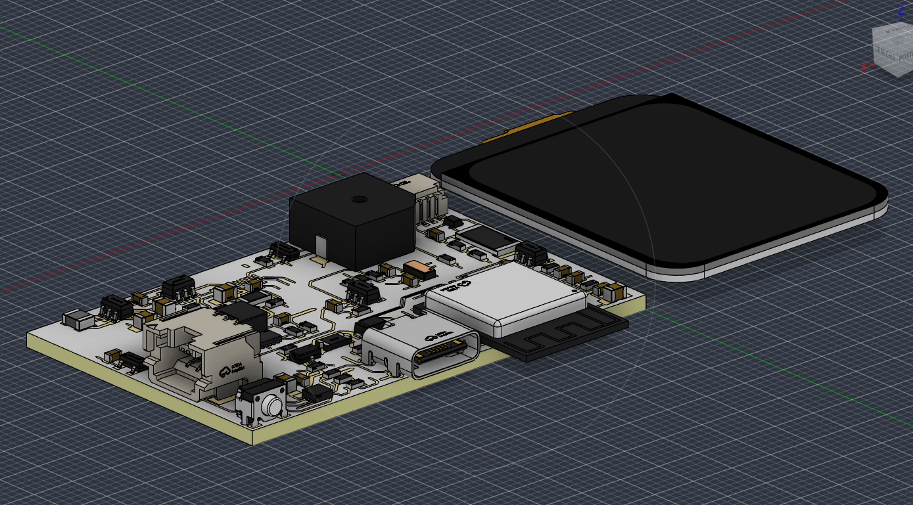
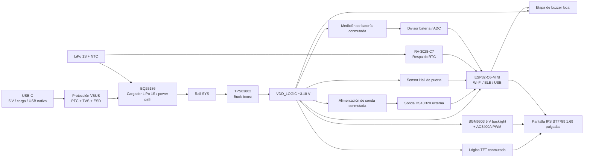
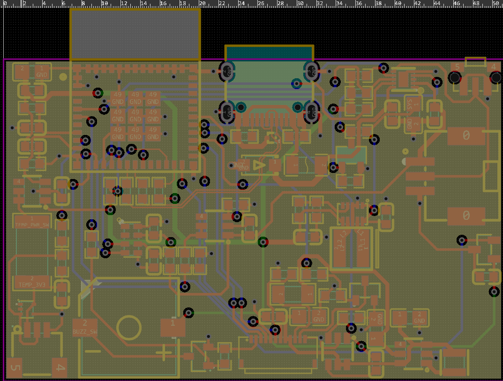
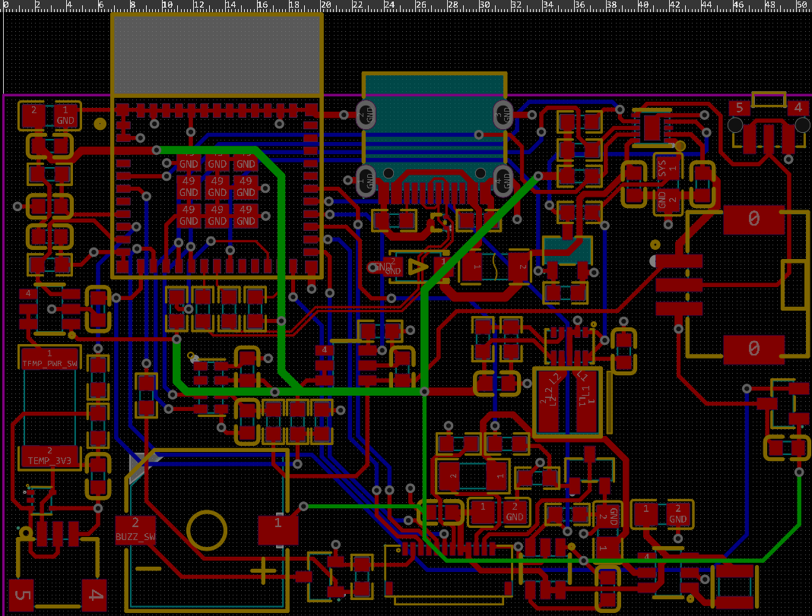
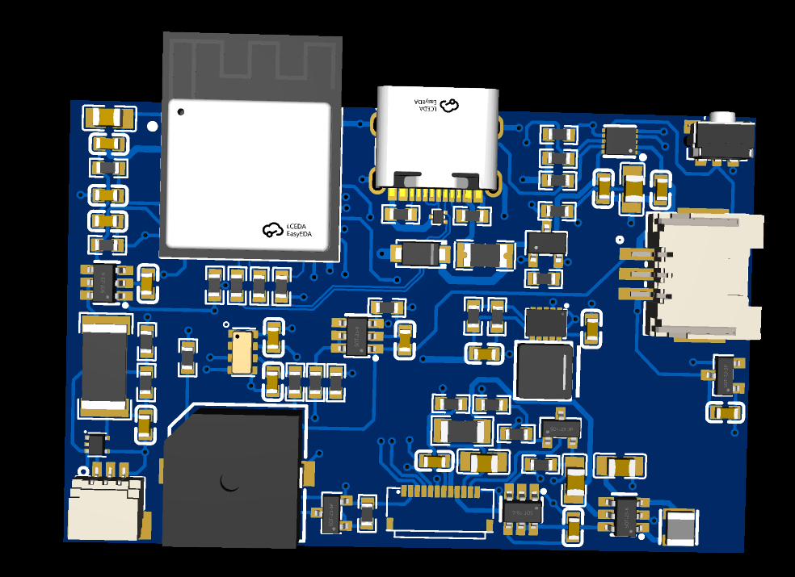
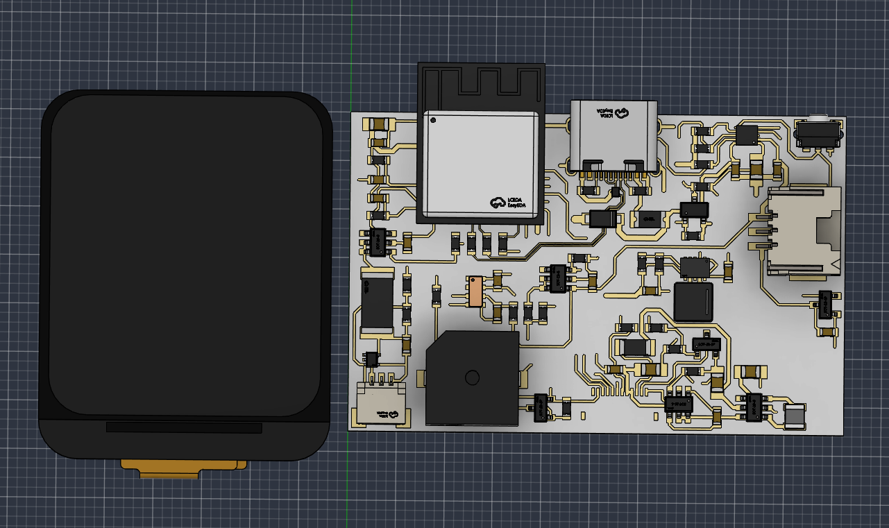
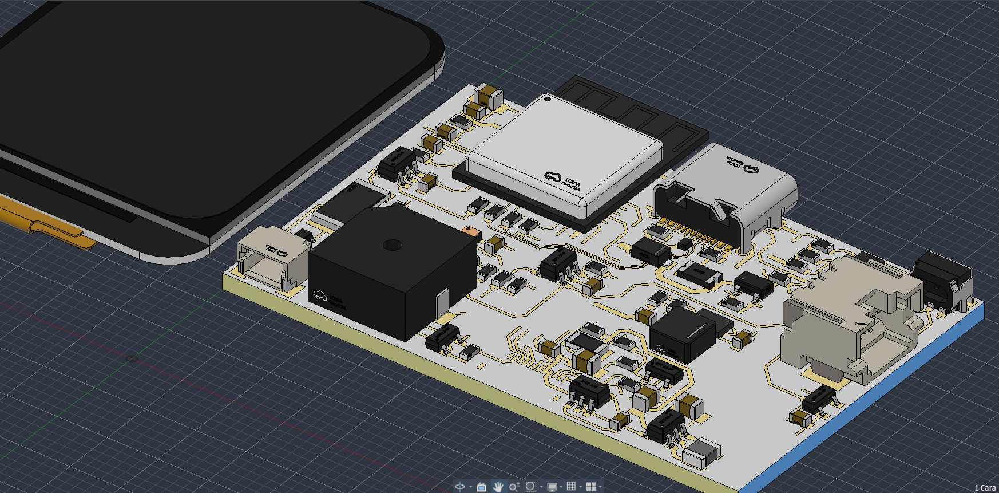

# P1 Rev B — Monitor inteligente retrofit para refrigeración comercial

**Hardware embebido · PCB de 4 capas · Gestión de energía · Sensado · Conectividad · Integración de producto**

[English](README.md) · [PCB Rev B](hardware/pcb/rev_b/README.md) · [Arquitectura](docs/architecture.md) · [Decisiones de diseño](docs/design-decisions.md) · [Plan de validación](docs/validation-plan.md)

P1 Rev B es un **prototipo de monitorización de condición para refrigeración comercial** desarrollado alrededor de una PCB propia compacta de cuatro capas. El proyecto nació a partir de una necesidad real de piloto en un entorno de carnicería, donde se busca mejorar la visibilidad sobre el almacenamiento refrigerado de productos cárnicos sin modificar el controlador original ni intervenir el sistema del compresor.

El diseño está pensado para observar **temperatura, estado de puerta, alimentación/batería y eventos locales**, creando una base de hardware para que el firmware futuro pueda interpretar estas señales en conjunto en lugar de reducir el producto a un simple termómetro Wi-Fi.

<p align="center">
  
</p>

<p align="center"><em>Integración conceptual de la PCB Rev B con pantalla IPS de 1.69 pulgadas en Autodesk Fusion. La carcasa final continúa en desarrollo.</em></p>

> **Hito actual — hardware / PCB en pre-fabricación:** la arquitectura electrónica Rev B y el diseño PCB están completos a nivel de diseño. La revisión final de manufactura, fabricación, bring-up eléctrico, firmware, software/aplicación, carcasa CAD final y validación de campo corresponden a hitos posteriores.

## Por qué existe este proyecto

En refrigeración comercial puede perderse visibilidad cuando la temperatura sale del rango esperado, una puerta permanece abierta demasiado tiempo, la alimentación externa falla o la conectividad remota deja de estar disponible.

P1 se planteó como un **monitor retrofit externo**, capaz de añadirse sin tomar control del refrigerador. Por ello el hardware prioriza:

- una sonda externa cableada para medir la temperatura dentro del espacio refrigerado;
- detección de puerta mediante sensor Hall de bajo consumo;
- pantalla local y alarma audible;
- operación con respaldo de batería;
- RTC para conservar timestamps de eventos;
- conectividad Wi-Fi/BLE mediante ESP32-C6;
- un único USB-C exterior para alimentación, carga y programación/servicio mediante USB nativo;
- una arquitectura que siga siendo útil aun cuando la conectividad remota no esté disponible.

El primer piloto está orientado a una aplicación de refrigeración en carnicería. Este repositorio documenta el desarrollo de ingeniería del prototipo; **no** presenta el dispositivo como sistema certificado de inocuidad, HACCP o metrología.

## Qué demuestra Rev B

Rev B representa el punto donde el proyecto pasó de un estudio inicial a una arquitectura electrónica orientada a producto.

Demuestra trabajo en:

- **hardware embebido con ESP32-C6**, Wi-Fi/BLE y USB Serial/JTAG nativo;
- **carga de LiPo 1S y power-path**;
- **buck-boost síncrono** como rail lógico principal estable;
- **cargas conmutadas** para reducir consumo durante sleep y mediciones;
- **interfaz para sonda DS18B20 externa** con protección de campo;
- **sensor Hall de bajo consumo** para estado de puerta;
- **RTC de ultrabajo consumo** con respaldo de batería;
- **pantalla IPS de 1.69 pulgadas** con lógica conmutada y backlight PWM;
- **alarma sonora local** independiente del cloud;
- **USB-C protegido y ruta de programación nativa**;
- **PCB de cuatro capas** con plano GND dedicado y distribución interna de potencia;
- placement consciente de RF, accesos de conectores e integración mecánica preliminar.

## Arquitectura funcional



La tarjeta se dividió deliberadamente en bloques funcionales para poder revisar y validar de forma independiente potencia, sensado, RF, interfaz de usuario y servicio.

## Bloques de hardware

| Bloque | Función | Implementación principal |
|---|---|---|
| **BLK01 — MCU / RF / Boot / Service** | Procesamiento embebido y conectividad inalámbrica | ESP32-C6-MINI, Wi-Fi/BLE, USB Serial/JTAG nativo, estados de boot definidos y UART interno de recuperación |
| **BLK02 — USB-C / ESD / VBUS** | Alimentación externa, carga y programación | USB-C, resistores CC, ESD de datos, resistencias serie, protección rearmable y protección de transientes en VBUS |
| **BLK03 — Batería / Cargador / Power Path** | Carga LiPo 1S y gestión de alimentación | TI BQ25186, NTC del pack y estrategia fail-safe para habilitación de carga |
| **BLK04 — Buck-Boost principal** | Rail lógico estable durante el rango de batería | TI TPS63802, objetivo VDD_LOGIC alrededor de 3.18 V |
| **BLK05 — RTC / validez temporal** | Timestamp aun con rail lógico principal apagado | Micro Crystal RV-3028-C7 con respaldo desde batería |
| **BLK06 — Medición de batería** | Adquisición de tensión con consumo sólo durante la medición | Divisor 33 kΩ / 10 kΩ conmutado por TPS22917 + filtrado ADC |
| **BLK07 — Sonda externa de temperatura** | Medición del espacio refrigerado | DS18B20 de 3 hilos alimentado, power switch, pull-up 1-Wire y protección ESD |
| **BLK08 — Sensor Hall de puerta** | Estado abierto/cerrado | TI DRV5032FADBZR omnipolar de bajo consumo |
| **BLK09 — TFT / Interfaz de usuario** | Estado local e interacción | EastRising ER-TFT1.69-3, ST7789, SPI 4-wire, rail lógico conmutado y backlight PWM |
| **BLK10 — Alarma local** | Alerta audible sin depender de servicios remotos | Buzzer activo de 3 V conmutado mediante AO3400A |

Más detalle en [arquitectura](docs/architecture.md) y [decisiones de diseño](docs/design-decisions.md).

## Arquitectura PCB de cuatro capas

Rev B utiliza una PCB de aproximadamente **52 × 34 mm** en la iteración actual. Los componentes principales se concentran en una cara para simplificar ensamblaje, inspección y retrabajo, preservando el lado opuesto para la integración de producto alrededor de batería/carcasa.

| Capa | Rol |
|---|---|
| **L1 — Top** | Componentes, señales y lazos locales compactos de potencia |
| **L2 — GND_PLANE** | Referencia continua de tierra y retorno de corriente |
| **L3 — PWR_SIG** | Distribución de VDD_LOGIC y potencia secundaria |
| **L4 — Bottom** | Señales secundarias y cruces de routing |

El salto a cuatro capas no es decorativo. L2 ofrece una referencia de retorno más continua, mientras L3 descarga la distribución de potencia de las capas de señales y favorece un entorno más limpio para USB, SPI, rutas cercanas a RF y convertidores conmutados.

<p align="center">
  
  
</p>

<p align="center"><em>L2 dedicado a GND para retorno de corriente e integridad de señal · L3 dedicado principalmente a VDD_LOGIC y distribución secundaria de potencia.</em></p>

<p align="center">
  
</p>

<p align="center"><em>Render actual de la PCB Rev B en EasyEDA Pro — vista de etapa de diseño, previa a fabricación.</em></p>

## Método de ingeniería

El diseño se trabajó bloque por bloque siguiendo el mismo flujo:

**requisito → selección exacta de pieza → datasheet → pinout → revisión de footprint/librería → esquema → revisión eléctrica → placement → routing → DRC local → validación teórica → prueba de banco planificada**

Reglas aplicadas durante el desarrollo:

- no inventar MPN, footprints ni valores eléctricos cuando falte evidencia;
- separar decisiones confirmadas de propuestas y gates de prueba;
- reducir BOM y evitar módulos hobby cuando la integración a nivel de componente permite un producto más controlado;
- mantener compactos los lazos switching/potencia y conservar una referencia GND continua;
- definir estados seguros durante reset para carga, sensores conmutados, display/backlight y salidas;
- mantener servicio exterior simple con un único USB-C y accesos internos mínimos de recuperación;
- tratar un DRC limpio como verificación de diseño/manufactura, **no** como prueba de funcionalidad eléctrica.

## Selección de componentes principales

| Función | Pieza / familia | Motivo de selección |
|---|---|---|
| MCU / RF | ESP32-C6-MINI | Wi-Fi/BLE integrados, USB nativo e integración compacta |
| Cargador / power path | TI BQ25186 | Carga LiPo 1S, power path, NTC y comportamiento configurable |
| Convertidor principal | TI TPS63802 | Buck-boost síncrono compacto, bajo IQ y arquitectura de potencia orientada a producto |
| RTC | Micro Crystal RV-3028-C7 | Consumo muy bajo y respaldo independiente |
| Load switch | TI TPS22917 | Conmutación de bajo leakage para sonda, lógica TFT y medición de batería |
| Sensor de puerta | TI DRV5032FADBZR | Hall omnipolar, push-pull y bajo consumo |
| ESD de sonda | TI TPD2E2U06DRLR | Protección en la interfaz de campo de la sonda |
| Sonda temperatura | DS18B20 | 1-Wire y ecosistema amplio de sondas cableadas |
| Pantalla | EastRising ER-TFT1.69-3 | IPS 1.69", 240×280, ST7789 y documentación SPI 4-wire |
| FPC display | Panasonic AYF531235 | 12 pines, pitch 0.5 mm |
| Boost backlight | SGMICRO SGM6603-5.0 | Boost síncrono fijo a 5 V para backlight |
| MOSFET switching | AO3400A | N-MOSFET apto para control lógico de bajo voltaje |
| Alarma | FUET-9650B-3V | Buzzer activo compacto |

La BOM detallada debe mantenerse vinculada al diseño Rev B activo y no reconstruirse desde documentos antiguos de Rev A.

## Cálculos documentados antes de fabricar

### Medición de batería

El divisor conmutado utiliza **33 kΩ / 10 kΩ**:

```text
VADC = VBAT × 10 / 43
```

Con una batería a 4.20 V:

```text
VADC ≈ 0.977 V
```

La corriente del divisor mientras está habilitado es aproximadamente **97.7 µA**. El voltaje final deberá calibrarse contra DMM; el ADC crudo no se presenta como un estado de carga exacto.

### Backlight de pantalla

La etapa SGM6603 busca generar 5 V. Con el resistor actual de 47 Ω y un Vf aproximado de 3.0 V, el cálculo de primer orden sitúa la corriente alrededor de **42.6 mA**. La corriente real debe medirse en hardware y el bring-up inicial del firmware deberá arrancar con brillo mínimo/cero.

### Presupuesto de potencia

El pico del sistema se espera dominado por Wi-Fi TX del ESP32-C6. La arquitectura fue dimensionada con margen, pero autonomía, corriente de batería, temperatura de convertidores y consumo total siguen siendo **variables por medir**, no prestaciones publicadas.

## Integración mecánica

La electrónica se ha desarrollado pensando en integración de producto y no solamente como una placa de desarrollo aislada.

<p align="center">
  
  
</p>

<p align="center"><em>Estudios preliminares de integración mecánica utilizados para revisar volumen PCB/display, accesos de conectores y distribución de componentes.</em></p>

La integración preliminar en Autodesk Fusion se utiliza para estudiar:

- volumen PCB + pantalla de 1.69";
- acceso a conectores;
- despeje de antena;
- posición de batería;
- puerto acústico para buzzer;
- geometría Hall/imán;
- mantenibilidad futura de la carcasa.

La **carcasa final todavía no está diseñada ni impresa**. Las vistas actuales son estudios de integración, no fotografías de un producto fabricado.

## Estado actual

| Área | Estado |
|---|---|
| Arquitectura hardware Rev B | **Definida** |
| Esquemático | **Hito de diseño completado / resta revisión pre-fabricación** |
| Layout PCB de cuatro capas | **Diseño PCB completado en el hito actual** |
| Arquitectura display/backlight | **Seleccionada a nivel de diseño** |
| Integración EasyEDA / Fusion | **Integración 3D preliminar disponible** |
| Auditoría final pre-Gerber | **Siguiente paso** |
| Fabricación / ensamblaje PCB | **Pendiente** |
| Bring-up eléctrico | **Pendiente** |
| Firmware / máquina de estados | **Pendiente** |
| Software propio de monitorización | **Pendiente** |
| Carcasa CAD final / impresión 3D | **Pendiente** |
| Validación de batería / RF / térmica / campo | **Pendiente** |

## Próximos hitos

1. Cerrar los gates finales pre-fabricación: cálculo de impedancia USB con stackup real, DRC/repour final, revisión BOM/PNP y estrategia de apagado físico.
2. Generar y revisar Gerbers fuera del editor PCB.
3. Fabricar y ensamblar la primera PCB Rev B.
4. Ejecutar bring-up por bloques y registrar rails, corriente, temperatura y comportamiento switching.
5. Integrar pantalla física, sonda de temperatura, Hall, buzzer y pack de batería seleccionado.
6. Implementar firmware para sensado, máquinas de estados, alarmas locales, logging con timestamp y conectividad.
7. Desarrollar la capa de software propia para monitorización.
8. Completar CAD de carcasa e imprimir prototipos mecánicos.
9. Ejecutar pruebas de autonomía, RF, térmicas y validación del piloto en refrigeración real.

## Estructura del repositorio

```text
P1-Refrigeration-Monitor/
├── README.md
├── README.es.md
├── hardware/
│   ├── pcb/rev_b/README.md
│   └── bom/
├── firmware/README.md
├── mechanical/README.md
└── docs/
    ├── architecture.md
    ├── design-decisions.md
    ├── validation-plan.md
    └── images/README.md
```

Los archivos de manufactura, firmware y CAD final se añadirán únicamente cuando esos hitos existan realmente.

## Declaración de estado

**Hito de diseño hardware Rev B completado a nivel PCB. Siguiente etapa: revisión de manufactura, primera fabricación, bring-up eléctrico, integración de firmware, diseño de carcasa, desarrollo de software y validación del piloto en refrigeración comercial.**

P1 Rev B es un prototipo en desarrollo. Actualmente no se presenta como sistema certificado de inocuidad, dispositivo HACCP, instrumento metrológico calibrado ni producto comercial validado.

## Autor

**Luis Alejandro Pérez Sousa**  
Ingeniería Mecatrónica · Sistemas Embebidos · Electrónica · Diseño PCB · Integración Hardware/Firmware
