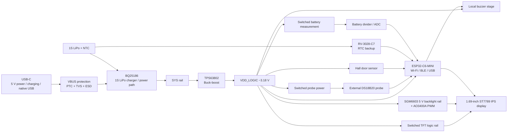

# P1 Rev B — Smart Retrofit Monitor for Commercial Refrigeration

**Embedded Hardware · 4-Layer PCB · Power Management · Sensing · Connectivity · Product Integration**

[Español](README.es.md) · [PCB Rev B](hardware/pcb/rev_b/README.md) · [Architecture](docs/architecture.md) · [Design decisions](docs/design-decisions.md) · [Validation plan](docs/validation-plan.md)

P1 Rev B is a **retrofit condition-monitoring prototype for commercial refrigeration**, built around a compact custom four-layer PCB. The project originated from a real pilot need in a butcher-shop refrigeration environment, where the goal is to improve visibility over refrigerated meat storage without modifying the refrigerator's original controller or compressor system.

The design is intended to observe **temperature, door state, power/battery condition and local events**, providing a hardware foundation for future firmware capable of interpreting those signals together rather than treating the product as just another Wi-Fi thermometer.

<p align="center">
  
</p>

<p align="center"><em>Conceptual integration of the Rev B PCB and 1.69-inch IPS display in Autodesk Fusion. Final enclosure still in development.</em></p>

> **Current milestone — hardware / PCB pre-fabrication:** the Rev B electronic architecture and PCB design are complete at design level. Final manufacturing review, fabrication, electrical bring-up, firmware, application/software, final enclosure CAD and field validation remain subsequent milestones.

## Why this project exists

Commercial refrigeration can lose useful visibility when temperature drifts outside the desired range, a door remains open longer than expected, external power is interrupted, or remote connectivity is unavailable.

P1 was conceived as an **external retrofit monitor** that can be added without taking control of the refrigerator. The hardware therefore prioritizes:

- an external wired temperature probe for the refrigerated space;
- door-state sensing through a low-power Hall sensor;
- local display and audible alarm;
- battery-backed operation;
- local timekeeping for event timestamps;
- Wi-Fi/BLE connectivity through ESP32-C6;
- one external USB-C port for power, charging and native USB programming/service;
- a hardware architecture designed to remain useful even when remote connectivity is unavailable.

The first pilot is intended for a butcher-shop refrigeration use case. This repository documents the engineering development of the prototype; it does **not** present the device as a certified food-safety, HACCP or metrology instrument.

## What Rev B demonstrates

Rev B is the point where the project moved from an early study into a product-oriented electronics architecture.

It demonstrates work across:

- **ESP32-C6 embedded hardware** with Wi-Fi/BLE and native USB Serial/JTAG;
- **1-cell LiPo charging and power-path management**;
- a **synchronous buck-boost main rail** for stable logic power across battery conditions;
- **switched loads** to reduce unnecessary consumption during sleep/measurement cycles;
- **external DS18B20 temperature-probe interface** with field-side protection;
- **low-power Hall sensing** for door state;
- **ultra-low-power RTC** with battery-backed time retention;
- **1.69-inch IPS display integration** with switched logic power and PWM-controlled backlight;
- **local audible alarm** independent of cloud connectivity;
- **USB-C protection and native programming path**;
- a **four-layer PCB stack** with a dedicated ground plane and internal power distribution;
- RF-aware placement, connector access and preliminary mechanical integration.

## Functional architecture



The board is deliberately partitioned into functional blocks so power, sensing, RF, user interface and service paths can be reviewed and validated independently.

## Hardware blocks

| Block | Function | Main implementation |
|---|---|---|
| **BLK01 — MCU / RF / Boot / Service** | Embedded processing and wireless connectivity | ESP32-C6-MINI, Wi-Fi/BLE, native USB Serial/JTAG, defined boot states, internal recovery UART |
| **BLK02 — USB-C / ESD / VBUS** | External power, charging input and programming | USB-C, CC resistors, data ESD, series resistors, resettable protection and VBUS transient protection |
| **BLK03 — Battery / Charger / Power Path** | 1S LiPo charging and system-power management | TI BQ25186, pack NTC input and fail-safe charge-enable strategy |
| **BLK04 — Main Buck-Boost** | Stable logic rail across battery operating range | TI TPS63802, target VDD_LOGIC around 3.18 V |
| **BLK05 — RTC / Time Validity** | Event timestamps while the main logic rail is off | Micro Crystal RV-3028-C7 with battery backup |
| **BLK06 — Battery Measurement** | Low-duty-cycle battery-voltage acquisition | TPS22917-switched 33 kΩ / 10 kΩ divider + ADC filtering |
| **BLK07 — External Temperature Probe** | Refrigerated-space temperature sensing | Powered 3-wire DS18B20, switched supply, 1-Wire pull-up and ESD protection |
| **BLK08 — Door Hall Sensor** | Open/closed door state | TI DRV5032FADBZR omnipolar low-power Hall sensor |
| **BLK09 — TFT / User Interface** | Local status and interaction | EastRising ER-TFT1.69-3, ST7789, 4-wire SPI, switched logic rail and PWM backlight |
| **BLK10 — Local Alarm** | Audible alert independent of remote services | Active 3 V buzzer driven through AO3400A |

More detail is available in [architecture](docs/architecture.md) and [design decisions](docs/design-decisions.md).

## Four-layer PCB architecture

Rev B uses an approximately **52 × 34 mm** PCB in the current design iteration, with the main components concentrated on one side to simplify assembly, inspection and rework while preserving the opposite side for product integration around the battery/enclosure.

| Layer | Role |
|---|---|
| **L1 — Top** | Components, signals and compact local power loops |
| **L2 — GND_PLANE** | Continuous ground reference and current return |
| **L3 — PWR_SIG** | VDD_LOGIC and secondary power distribution |
| **L4 — Bottom** | Secondary signals and routing crossovers |

Moving to a four-layer stack was not cosmetic. A dedicated L2 ground plane provides a more continuous return reference, while L3 removes power-distribution congestion from the signal layers and supports a cleaner environment for USB, SPI, RF-adjacent routing and switching converters.

<p align="center">
  
  
</p>

<p align="center"><em>L2 dedicated ground plane for current return and signal integrity · L3 used primarily for VDD_LOGIC and secondary power distribution.</em></p>

<p align="center">
  
</p>

<p align="center"><em>Current Rev B PCB render in EasyEDA Pro — design-stage view, prior to fabrication.</em></p>

## Engineering process

The design was developed block by block using the same workflow:

**requirement → exact part selection → datasheet review → pinout → footprint/library check → schematic → electrical review → placement → routing → local DRC → theoretical validation → planned bench test**

Key rules used throughout the project include:

- do not invent MPNs, footprints or electrical values when evidence is incomplete;
- distinguish confirmed decisions from proposed items and bench-test gates;
- minimize unnecessary BOM and hobby modules where component-level integration provides better control;
- keep switching/power loops compact and preserve a continuous ground reference;
- define safe/default states for charging, switched sensors, display/backlight and outputs during reset;
- keep external service simple through a single USB-C interface while retaining minimal internal recovery access;
- treat a clean DRC as a design/manufacturing check, **not** proof of electrical functionality.

## Selected component decisions

| Function | Selected part / family | Why it was selected |
|---|---|---|
| MCU / RF | ESP32-C6-MINI | Integrated Wi-Fi/BLE, native USB and compact embedded integration |
| Charger / power path | TI BQ25186 | 1S LiPo charging, power path, NTC monitoring and configurable behavior |
| Main converter | TI TPS63802 | Compact synchronous buck-boost with low-IQ product-oriented power architecture |
| RTC | Micro Crystal RV-3028-C7 | Very low current and independent backup operation |
| Load switching | TI TPS22917 | Low-leakage switching for probe, display logic and battery measurement |
| Door sensing | TI DRV5032FADBZR | Omnipolar, push-pull and low-power Hall sensing |
| Probe protection | TI TPD2E2U06DRLR | Protection at the external temperature-probe interface |
| Temperature probe | DS18B20 | Simple 1-Wire field probe ecosystem |
| Display | EastRising ER-TFT1.69-3 | 1.69-inch IPS, 240×280, ST7789, documented 4-wire SPI interface |
| Display FPC | Panasonic AYF531235 | 12-pin, 0.5 mm pitch FPC interface |
| Backlight boost | SGMICRO SGM6603-5.0 | Compact fixed 5 V synchronous boost for the display backlight |
| MOSFET switching | AO3400A | Low-voltage logic-compatible N-MOSFET for backlight/buzzer switching |
| Local alarm | FUET-9650B-3V | Compact active audible alarm |

The detailed BOM should remain tied to the active Rev B design rather than being reconstructed from older Rev A documents.

## Design calculations documented before fabrication

### Battery measurement

The switched battery divider uses **33 kΩ / 10 kΩ**:

```text
VADC = VBAT × 10 / 43
```

At 4.20 V battery voltage:

```text
VADC ≈ 0.977 V
```

The divider current while enabled is approximately **97.7 µA**. With the documented 100 nF capacitor, the RC settling time supports a short delay before ADC sampling. Final voltage reporting must be calibrated against a DMM; raw ADC voltage is not treated as an exact state-of-charge measurement.

### Display backlight

The backlight stage targets 5 V from the SGM6603. Using the current design's 47 Ω resistor and an approximate 3.0 V LED forward voltage gives a first-order estimate around **42.6 mA**. The real current must be measured on hardware, and initial firmware bring-up should start with minimum/zero backlight duty.

### Power budget

Peak system current is expected to be dominated by ESP32-C6 Wi-Fi transmission rather than by the TFT logic itself. The architecture was sized with margin, but battery current, converter temperature and total consumption remain **measurement items**, not published performance claims.

## Mechanical integration

The electronics were developed with product packaging in mind rather than as a bare development board.

<p align="center">
  
  
</p>

<p align="center"><em>Preliminary mechanical integration studies used to review PCB/display volume, connector access and component distribution.</em></p>

Preliminary Autodesk Fusion work is being used to study:

- PCB + 1.69-inch display volume;
- connector access;
- antenna clearance;
- battery placement;
- acoustic opening requirements for the buzzer;
- Hall-sensor / magnet geometry;
- future enclosure serviceability.

The **final enclosure has not yet been designed or printed**. Current 3D views are integration studies, not photographs of a fabricated product.

## Current project status

| Area | Status |
|---|---|
| Rev B hardware architecture | **Defined** |
| Schematic | **Design milestone completed / pre-fabrication review remains** |
| Four-layer PCB layout | **PCB design completed at current milestone** |
| Display/backlight architecture | **Selected at design level** |
| EasyEDA / Fusion integration | **Preliminary 3D integration available** |
| Final pre-Gerber manufacturing audit | **Next** |
| PCB fabrication / assembly | **Pending** |
| Electrical bring-up | **Pending** |
| Firmware / event state machine | **Pending** |
| Custom monitoring software | **Pending** |
| Final enclosure CAD / 3D print | **Pending** |
| Battery / RF / thermal / field validation | **Pending** |

## Next milestones

1. Close final pre-fabrication gates: USB differential-impedance calculation with the actual stackup, final DRC/repour, BOM/PNP review and power-off strategy.
2. Generate and inspect Gerbers outside the PCB editor.
3. Fabricate and assemble the first Rev B board.
4. Perform block-by-block electrical bring-up and log rails, current, temperature and switching behavior.
5. Integrate the physical display, temperature probe, Hall sensor, buzzer and selected battery pack.
6. Implement firmware for sensing, state machines, local alarms, time-stamped event logging and connectivity.
7. Develop the dedicated monitoring software layer.
8. Complete enclosure CAD and print mechanical prototypes.
9. Run battery-life, RF, thermal and refrigeration-field validation.

## Repository structure

```text
P1-Refrigeration-Monitor/
├── README.md
├── README.es.md
├── hardware/
│   ├── pcb/rev_b/README.md
│   └── bom/
├── firmware/README.md
├── mechanical/README.md
└── docs/
    ├── architecture.md
    ├── design-decisions.md
    ├── validation-plan.md
    └── images/README.md
```

Manufacturing files, firmware and final CAD will be added only when those milestones actually exist.

## Project status statement

**Rev B hardware design milestone complete at PCB level. Next: manufacturing review, first build, electrical bring-up, firmware integration, enclosure design, software development and commercial-refrigeration pilot validation.**

P1 Rev B is a prototype under development. It is not currently presented as a certified food-safety system, HACCP device, calibrated metrology instrument or validated commercial product.

## Author

**Luis Alejandro Pérez Sousa**  
Mechatronics Engineering · Embedded Systems · Electronics · PCB Design · Hardware/Firmware Integration
