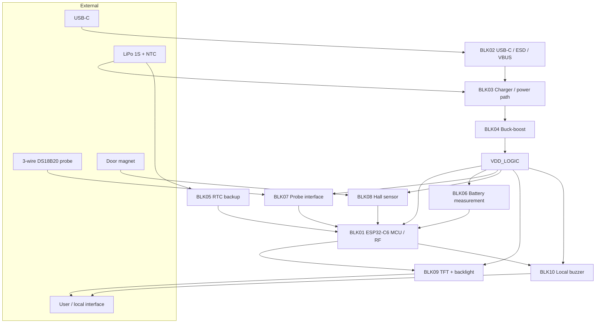

# Rev B hardware architecture

This document expands the block-level architecture of P1 Rev B. The design is currently a **pre-fabrication hardware milestone**; the blocks described here are design intent and schematic/PCB implementation, not yet bench-validated performance.

## Product boundary

P1 is an external retrofit monitor. It is designed to observe refrigerator condition without commanding the compressor or replacing the refrigerator's native control system.

Primary physical interfaces:

- wired internal temperature probe;
- local Hall sensor + external magnet for door state;
- local TFT display;
- local buzzer;
- 1-cell LiPo battery;
- one external USB-C port;
- Wi-Fi/BLE radio through ESP32-C6.

## Block map

## BLK01 — MCU / RF / Boot / Service

The ESP32-C6-MINI is the embedded core. The architecture reserves Wi-Fi/BLE, native USB Serial/JTAG and GPIO resources for display, Hall sensing, temperature probe, charger interaction, buzzer and battery measurement.

The antenna is intentionally placed at the PCB edge / outside the dense component region to preserve the future RF environment. Final RF behavior must be checked with the real battery, display and enclosure installed.

UART is retained only as an internal recovery/service path; normal external programming/service is intended through the single USB-C connector.

## BLK02 — USB-C / ESD / VBUS

The external USB-C connector combines power/charging with native ESP32-C6 USB programming.

Design elements include:

- GPIO12 = USB_D−;
- GPIO13 = USB_D+;
- 5.1 kΩ CC resistors;
- low-capacitance data-line ESD protection;
- 22 Ω series resistors;
- resettable VBUS protection;
- TVS protection on VBUS.

A clean PCB DRC does not validate differential impedance. The final 90 Ω differential design must be calculated against the selected manufacturer's real stackup before fabrication.

## BLK03 — Battery / charger / power path

The TI BQ25186 manages a 1-cell LiPo and system power path.

The design includes a fail-safe CE# strategy so charging does not unintentionally start in an undefined state during reset. TS/MR is tied to the battery-pack NTC path.

The final battery pack must provide a known BAT+/NTC/GND pinout, and its real NTC R25/Beta data must be characterized before normal charging is enabled.

## BLK04 — Main buck-boost

The TPS63802 converts SYS into the main VDD_LOGIC rail.

The target is approximately **3.18 V**, giving margin relative to the selected TFT's 3.3 V maximum operating requirement while remaining suitable for ESP32-C6 and the selected peripherals.

The converter uses a compact 470 nH inductor and local decoupling. Final feedback-divider tolerance is a pre-Gerber gate.

## BLK05 — RTC / time validity

The RV-3028-C7 is backed from BAT+ through its dedicated path so event time can remain valid even when the main logic rail is off.

Firmware must explicitly configure backup behavior and keep RTC trickle charge disabled unless a future design review proves it is appropriate.

## BLK06 — Switched battery measurement

A TPS22917 enables the battery divider only when a measurement is needed.

Current design:

- upper resistor: 33 kΩ;
- lower resistor: 10 kΩ;
- filter capacitor: 100 nF;
- BAT_MEAS_EN controlled by the MCU;
- ADC result requires calibration against a DMM.

The measurement is voltage telemetry, not direct state-of-charge truth.

## BLK07 — External temperature probe

The product uses an externally wired, powered 3-wire DS18B20 probe rather than locating the main PCB inside the refrigerated volume.

The interface includes:

- switched probe power through TPS22917;
- 47.5 Ω current-limiting element in the probe supply path;
- 4.7 kΩ 1-Wire pull-up;
- 100 Ω series element;
- external-interface ESD protection.

The final field cable/probe assembly is intended to use a finished commercial/OEM probe and a properly crimped product connector.

## BLK08 — Door Hall sensor

The DRV5032FADBZR is located close to the PCB edge for interaction with a magnet mounted on the moving door.

Mechanical design must control:

- magnet orientation/distance;
- Hall location relative to the enclosure wall;
- nearby screws/ferromagnetic material;
- behavior while buzzer and display backlight are active.

## BLK09 — TFT / user interface

Selected display: **EastRising ER-TFT1.69-3**, 1.69-inch IPS, 240×280, ST7789, 4-wire SPI.

The interface uses a Panasonic AYF531235 FPC connector. TFT logic power is switched through a TPS22917. The display backlight uses a dedicated SGM6603-5.0 boost rail and an AO3400A low-side PWM stage.

Final insertion/orientation must be physically verified with the real FPC display.

## BLK10 — Local alarm

An active FUET-9650B-3V buzzer is powered from VDD_LOGIC and switched through an AO3400A.

The enclosure must include an acoustic opening and the physical assembly must be tested for audible output and interaction with Hall sensing/RF.
