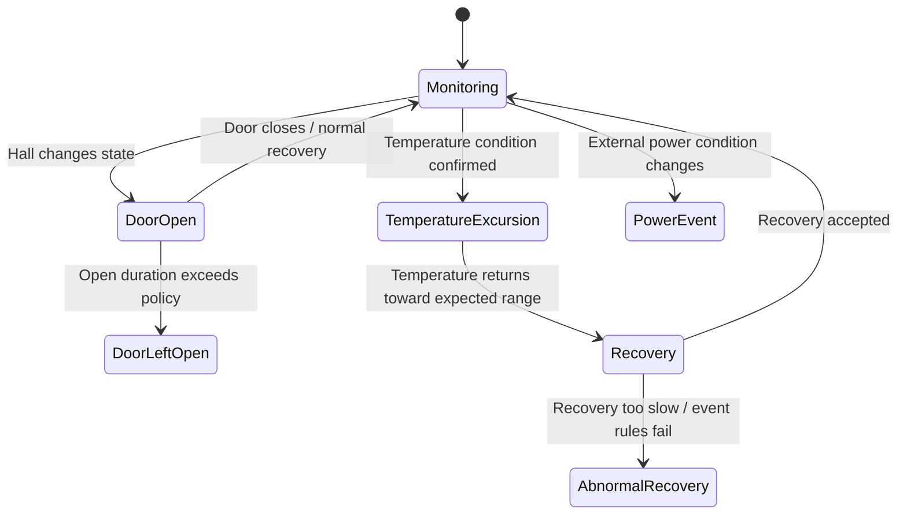

# Firmware roadmap

Firmware implementation is **pending** for the Rev B hardware.

This folder exists to keep the hardware/software evolution traceable without pretending that unimplemented functionality already exists.

## Intended responsibilities

Future firmware is expected to coordinate:

- external DS18B20 temperature sampling;
- door-state acquisition;
- battery-voltage measurement;
- RTC-backed timestamps;
- local TFT status/UI;
- local buzzer alarms;
- Wi-Fi/BLE connectivity;
- local event logging;
- communication with the future dedicated monitoring software.

## Planned application logic

The long-term goal is contextual refrigerator-condition monitoring rather than single-threshold temperature alarms.

Candidate event states include:

Exact thresholds, timing rules and classifications must be derived and validated after hardware bring-up and real refrigeration data collection.

## Development principles

- explicit finite-state machines rather than scattered conditionals;
- non-blocking scheduling;
- configuration separated from application logic;
- hardware drivers isolated from event logic;
- local behavior should remain functional during remote-connectivity loss;
- event records should carry RTC timestamps;
- firmware version/PCB revision should be traceable in validation logs;
- no battery-life, alarm-performance or connectivity claim without measured evidence.
